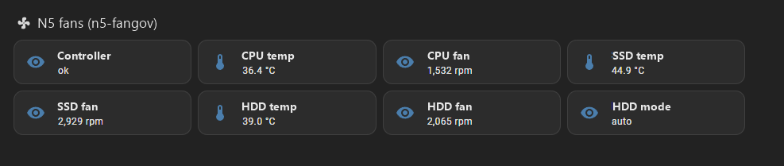

# API and integrations

How a script, Home Assistant or an agent talks to the daemon. Request and response
bodies are in the OpenAPI document the daemon serves, not here.

## Reaching the API

Base URL = the dashboard's address: `http://127.0.0.1:8010` (scope `local`) or
`https://n5host:8010` (`lan`, [Setup](03-setup.md)). Everything is under `/api/`;
answers are JSON, errors `{"error": "…"}` (plus `"errors": [...]` where a list
exists). The `Host` header must be an IP literal, `localhost`, the listen host or an
`allowed_hosts` entry; any other name gets 421
([Host header](08-https-security.md#host-header-and-csrf)).

The automatic certificate is self-signed. Either trust it on the client
(`n5-fangov cert export n5host.crt`, then `curl --cacert n5host.crt …`;
[The certificate](08-https-security.md#the-certificate)) or skip verification
(`curl -k`, `verify_ssl: false`) on a LAN you trust.

The CLI does not use this port; it talks over the root-only unix socket without
credentials ([The socket](05-cli.md#the-socket)).

## Authentication

With `auth = "none"` (loopback default) nothing is needed. With `auth = "basic"` there
are three ways:

| Caller | Sends | For |
|---|---|---|
| Browser session | cookie `n5fangov_session` + header `X-N5-Fangov-Csrf: 1` on writes | the dashboard |
| Basic auth | `Authorization: Basic …` (`curl -u admin`) + `X-N5-Fangov-Csrf: 1` on writes | one-off shell commands with the admin password |
| **API token** | `Authorization: Bearer n5t_...` — **no CSRF header** | scripts, Home Assistant, monitoring, agents |

Use an API token for anything that runs unattended. Create one in the dashboard
(Settings → *API tokens*) or with
`n5-fangov token create NAME --scope read|control|admin [--ttl DAYS]`; the secret is
shown once. Storage, expiry, revocation, rate limit and what a token can never do:
[API tokens](08-https-security.md#api-tokens).

In the examples `n5t_...` stands for the whole secret as `token create` printed it;
`Authorization: Bearer <token>` sent literally is a 401. `GET /api/session` with the
token answers `"via": "bearer"` and the scope, the quickest proof that the header
arrived intact.

```
# read: the full snapshot (anonymous callers get the reduced one)
curl -H "Authorization: Bearer n5t_..." https://n5host:8010/api/state
curl -H "Authorization: Bearer n5t_..." https://n5host:8010/api/session     # {"authenticated":true,"via":"bearer","scope":"read",…}

# control: manual override and back to the curve — no CSRF header for a token
curl -X PUT -H "Authorization: Bearer n5t_..." -H "Content-Type: application/json" \
     -d '{"duty":180}' https://n5host:8010/api/override/hdd
curl -X DELETE -H "Authorization: Bearer n5t_..." https://n5host:8010/api/override/hdd

# control: apply a preset
curl -X POST -H "Authorization: Bearer n5t_..." https://n5host:8010/api/presets/n5pro-quiet/apply

# the same with Basic auth needs the CSRF header
curl -u admin -X POST -H "X-N5-Fangov-Csrf: 1" https://n5host:8010/api/presets/n5pro-quiet/apply
```

Answers to expect: 401 (no or rejected credentials, an expired or revoked token
included), 403 (scope, or a token on a session-only endpoint), 421 (Host), 429 (login
throttling or the per-token rate limit `{"error":"token rate limit"}`), 202 on a config
write that needs a restart. A rejected token counts like a wrong password
([Login throttling](08-https-security.md#login-throttling)).

## Scopes

Cumulative; `read` is the default when a token is created.

| Scope | Allows |
|---|---|
| `read` | `GET` on `version`, `about`, `session`, `openapi.json`, `state`, `history`, `history.csv`, `system`, `sensors`, `profiles`, `presets`, `presets/{name}`, `alerts`, `dashboard`, `schedules`, `tls` (info only, not the certificate downloads), `driver`, `health` |
| `control` | `read` + `PUT`/`DELETE /api/override/{name}`, `POST /api/presets/{name}/apply`, `PUT /api/dashboard`, `POST /api/alerts/ack` |
| `admin` | everything the dashboard can do **except** token and account management |

No token, `admin` included, can reach `/api/tokens*`, `/api/account/*`, `/api/login` or
`/api/logout` (403): tokens are created, listed and revoked by a browser session or
Basic auth only. Out of scope: 403
`{"error":"token scope read does not allow PUT /api/override/cpu","scope":"read","required":"control"}`.

## OpenAPI

`GET /api/openapi.json` (public) is an OpenAPI 3.1 document rendered from the daemon's
route table, so it cannot drift from the server. It carries `info.version`, the
security schemes `bearer`, `basic` and `cookie`, and per operation the summary,
parameters, request body schema, response codes, `x-scope`
(`read`/`control`/`admin`/session-only) and `x-class` (`public`, `filtered`,
`protected`). Feed it to a generator, an API client or an agent:

```
curl -s https://n5host:8010/api/openapi.json | jq '.paths | keys'
```

## Endpoints

Method, path, scope and purpose; bodies and response shapes are in the OpenAPI
document. *Class* `public` needs no credentials, `filtered` answers anonymous callers
with a reduced document, `protected` needs credentials. *session* = browser session or
Basic auth only, never a token.

**No credentials**

| Method | Path | Class | Purpose |
|---|---|---|---|
| `GET` | `/api/version` | public | name, version, `prerelease`, `tls`, `auth`, the UI's validation `limits` |
| `GET` | `/api/about` | public | licence, repository, author, credits |
| `GET` | `/api/session` | public | who the caller is: `authenticated`, `mode`, `user`, `via` (`cookie`/`basic`/`bearer`/`none`), `scope` and `token_id` for a token |
| `GET` | `/api/openapi.json` | public | the OpenAPI document |
| `GET` | `/healthz` | public | liveness for monitors, [below](#healthz) |
| `GET` | `/api/state` | filtered | snapshot: status, `hw_status` (`validated`/`tested`/`experimental`/`unknown`; `verified` = validated or tested, kept for compatibility), channels (temperature, duty, target, RPM, mode, `assist {enabled, boost}` for a channel with an `[[assist]]` table; signed in also `held_temp`, `hold_until`, `ceiling`, `ceiling_hit`, the assist `source` and `sources[]`, EC and watched temperatures, alert stamps) |
| `GET` | `/api/history` | filtered | history points (`minutes`, `since`; anonymous: without `extra`) |
| `GET` | `/api/events` | filtered | events for the chart markers (`minutes`, `since`; anonymous: `ts`, `kind`, `ch`, `end` only), [below](#events) |

**Scope `read`**

| Method | Path | Purpose |
|---|---|---|
| `GET` | `/api/history.csv` | the same points as CSV attachment (`minutes`) |
| `GET` | `/api/system` | hardware inventory with live disk temperatures |
| `GET` | `/api/sensors` | sensor catalogue with live readings and `kind` |
| `GET` | `/api/profiles` | profiles with the active one; `hw_status` per profile on this machine |
| `GET` | `/api/presets`, `/api/presets/{name}` | preset list, one preset's channel tables |
| `GET` | `/api/schedules` | `[[schedule]]` entries, active, next and last switch, timezone (501 without a scheduler) |
| `GET` | `/api/alerts` | transport status (`webhook_url` full for a session or Basic auth, query and userinfo redacted for a token caller), kinds with last delivery, recent alerts with `id`, `ack_ts`, `ack_by`, and `open` (alerts not acknowledged) |
| `GET` | `/api/driver` | the loaded fan driver: `module`, `version`, `srcversion`, `mode`, `expected` (what the installed driver package builds), `pending` (reload needed) |
| `GET` | `/api/health` | the checks of `n5-fangov check`, the kernel gate as `check --after-update` stored it, the driver, daemon start, last restart/failed/emergency/kernel/driver alert (computed at most every 15 s) |
| `GET` | `/api/dashboard` | the watched sensor ids |
| `GET` | `/api/tls` | certificate mode, info, warnings, fallback flag |
| `POST` | `/api/preview` | curve preview over the recorded history: draft channels, a preset or assist switches; writes nothing, one at a time (429) — [below](#preview) |

**Scope `control`**

| Method | Path | Purpose |
|---|---|---|
| `PUT` | `/api/override/{name}` | manual duty (`{duty}` or `{percent}`; HDD-like channels ≥ 60) |
| `DELETE` | `/api/override/{name}` | back to the curve |
| `POST` | `/api/panic` | full cooling: `{"action":"start"}` (also to extend: 10 min from now) or `{"action":"stop"}`; answers `{active, until}`; 409 with the reason when the daemon cannot drive the fans — [below](#full-cooling) |
| `POST` | `/api/presets/{name}/apply` | apply a preset (merge by pwm; 202 when a restart is needed) |
| `PUT` | `/api/dashboard` | set the watched sensor ids |
| `PUT` | `/api/assist/{name}` | switch the channel's `[[assist]]` table: `{"enabled": true}` / `false`; writes only that `enabled` line, the file's `[[assist]]` tables apply on the next cycle; 404 without a table ([Assist](#assist)) |
| `POST` | `/api/alerts/ack` | acknowledge alerts: `{"ids":[41,42]}` or `{"all":true,"up_to":42}` (the newest id the client has seen); display only, [Alerts](07-alerts.md#acknowledging) |

**Scope `admin`**

| Method | Path | Purpose |
|---|---|---|
| `GET` | `/api/config` | raw TOML and the parsed config (hash redacted) |
| `PUT` | `/api/config[?strict=1]` | write the config file and reload (200 / 202 / 400) |
| `GET` | `/api/config/export` | settings bundle (config + presets, never tokens) |
| `POST` | `/api/config/import` | restore a bundle |
| `PUT` | `/api/presets/{name}` | save a preset: the running channel tables (empty body) or the channels of the JSON body ([below](#saving-a-preset-with-a-body)) |
| `POST` | `/api/presets/{name}/rename` | rename a user preset |
| `DELETE` | `/api/presets/{name}` | delete a user preset |
| `PUT` | `/api/alerts` | transport, `mail_to`, `webhook_url`, `webhook_format` |
| `POST` | `/api/alerts/test` | send a test alert through the real transport |
| `POST` | `/api/alerts/template` | install the PVE notification template |
| `GET` | `/api/log`, `/api/log/export` | log lines (`lines`), the whole current file |
| `DELETE` | `/api/log` | truncate the log file |
| `GET` | `/api/tls/cert.crt`, `/api/tls/cert.cer` | certificate download (PEM / DER) |
| `POST` | `/api/tls/regenerate`, `/api/tls/upload`, `/api/tls/reset` | certificate actions (409 with `tls = "off"`) |

**Session only** (403 for every token)

| Method | Path | Purpose |
|---|---|---|
| `POST` | `/api/login`, `/api/logout` | cookie session |
| `GET` | `/api/tokens` | token list (never the secrets) |
| `POST` | `/api/tokens` | create a token (`name`, `scope`, `ttl_days`; 201 with the secret once) |
| `DELETE` | `/api/tokens/{id}` | revoke |
| `GET` | `/api/account` | user, mode, sessions |
| `POST` | `/api/account/password`, `/api/account/user`, `/api/account/sessions/revoke` | credentials and sessions |

Body limits: 256 KiB config/import and preset body, 64 KiB certificate upload, 4 KiB
for override, login, account and token JSON (413 above). Every state-changing request
from a cookie or Basic caller needs `X-N5-Fangov-Csrf: 1`.

### Saving a preset with a body

`PUT /api/presets/{name}` (scope `admin`) with an **empty body** stores the `[[channel]]`
tables the daemon runs. With a JSON body it stores the channels of the body instead,
the preset editor's path. **Nothing is applied** to the daemon either way:

```json
{"channels": [
  {"name": "cpu", "pwm": 1, "sensor": "k10temp", "curve": [[45, 85], [80, 255]], "critical": 88, "stop": "auto"},
  {"name": "ssd", "pwm": 2, "sensor": "nvme:max", "curve": [[40, 74], [70, 255]], "critical": 75, "stop": "auto", "hysteresis": 2, "min_on": "1m"},
  {"name": "hdd", "pwm": 3, "sensor": "drivetemp:max,disk:sda", "curve": [[36, 105], [46, 255]], "critical": 56, "stop": "87", "hysteresis": 3, "min_on": "5m"}
]}
```

Schema `PresetSave`: `channels[]` (at least one) of `name`, `pwm`, `sensor` (several
ids joined by `,`), `curve` (`[temp_c, duty]` pairs) and `critical` (required), `stop`
(`auto`, empty = `auto`, or a fixed duty `60..255` as a string), `hysteresis`
(`0..10`), `min_on` (Go duration, `0s` = off). Unknown keys, a point that is not
exactly two values, and anything after the JSON object are 400. The body is parsed with
the config's own [curve rules](06-configuration.md#curve-rules); every warning the
lenient parser would replace by a default is an error here: `400 {"error": "preset
rejected", "errors": […]}`. The channel set must be the running config's (`name@pwmN`
per channel): 400 otherwise. A built-in name is 409, a body above 256 KiB 413, a write
failure 500, no preset store 501. 200 `{"ok": true, "saved": "<name>"}`.

```
curl -u admin -H "X-N5-Fangov-Csrf: 1" -H "Content-Type: application/json" \
  -X PUT --data @summer.json https://n5host:8010/api/presets/summer
```

## Assist

```
curl -H "Authorization: Bearer n5t_..." -H "Content-Type: application/json" \
  -X PUT --data '{"enabled": true}' https://n5host:8010/api/assist/hdd
```

Scope `control`. 200 `{"ok": true, "channel": "hdd", "enabled": true}`; 404 when the
channel has no valid `[[assist]]` table in `config.toml`; 400 for a body other than
`{"enabled": true|false}`; 500 when the file could not be written, or was written but
the table does not fit the running channel set (channels edited by hand: restart). The
daemon writes only the `enabled` line, comments and the other tables keep their bytes
([Assist](06-configuration.md#assist)). With the switch the daemon takes all
`[[assist]]` tables of the file on the next cycle: a table added, changed or removed by
hand takes effect with it, no restart.

`GET /api/state` carries per channel with a table:

```json
"assist": {"enabled": true, "boost": 45, "source": "hwmon:amdgpu:temp1",
           "sources": [{"sensor": "hwmon:amdgpu:temp1", "temp": 58.7, "boost": 45, "start": 50, "full": 58},
                       {"sensor": "nvme:max", "temp": 49.2, "boost": 40, "start": 46, "full": 50}]}
```

`boost` is what the target carries this cycle: 0 when off, outside mode `auto` or with
every source below `start`. `sources[].boost` is what each source alone gives, also
while assist is off; `temp` is `-999` for an unreadable source; `start` and `full` are the
source's thresholds from the config (°C, read-only). Anonymous callers get
`enabled` and `boost` only. A channel without a table has no `assist` member.

## Preview

```
curl -H "Authorization: Bearer n5t_..." -H "Content-Type: application/json" \
  -X POST --data '{"assist": {"hdd": true}, "span": "24h"}' https://n5host:8010/api/preview
```

Scope `read`; nothing is written. Every member is optional — no body computes the
running config, so the preview line can be checked against the recorded one:

| Member | Meaning |
|---|---|
| `channels` | draft channel tables as the curve editor holds them (`name`, `sensor`, `curve`, `critical`, `hysteresis`, `min_on`; `pwm` and `stop` default to the running channel's). A part of the channels is fine, the rest runs as configured. Validated like a [preset body](#saving-a-preset-with-a-body): 400 with `errors[]`; a name the daemon does not run is 400 |
| `preset` | the channels of this preset, merged by pwm like an apply (running names; post-processing and ceiling stay where the preset says nothing). Not together with `channels` (400); unknown 404 |
| `assist` | `{"hdd": true}`: the assist switch per channel for the computation; the values come from the running `[[assist]]` table, a channel without one is 400 |
| `span` | `24h` (1-min means, default) or `7d` (5-min means); anything else 400 |

The computation runs the daemon's own rules — curve at the hysteresis-held
temperature, `min_on`, assist with its hysteresis and hold, critical, ceiling — point
by point over the history tier. A draft sensor other than the running one is read from
the recorded extra sensors (assist sources are recorded automatically); missing there,
the channel gets `"error": "sensor not in history"`. A gap in the history (restart,
outage) stays a gap, and hysteresis and holds start afresh after it. One computation at
a time; a second request gets 429 instead of waiting.

Answer: `{span, step, note, order[], channels: {<name>: {series[{ts, actual, preview,
boost}], summary: {actual, preview}, error?, measured?, notes[]?}}}`. `actual` is the recorded duty
(null when unknown), `preview` the target (null where the history has no temperature),
`boost` the assist share. Each summary line carries `mean`, `p95`, `max`,
`min_ge_200` and `assist_min` (minutes). `measured` is set for an HDD channel with
assist on: the effect measured on 16.11.2026, labelled as measured, not predicted.

What the preview cannot show (`note`): feedback — more air would have lowered the
temperatures, so it shows rather too much duty, never too little; the ramp
(`step_up`/`step_down`); past overrides, failsafe and sensor errors, which only the
recorded line carries. On `7d` hysteresis and `min_on` barely act on 5-min means and
short peaks vanish. Also on `24h` a point is the mean of the 10-s cycles of its minute,
so hysteresis and `min_on` act on means, not on single readings. A ceiling of a
composite sensor is judged on the recorded maximum against the lowest part ceiling
(the history keeps no per-part readings), so a mixed composite (an NVMe and an HDD) can
show 255 where the daemon would not.

`notes[]` per channel lists such limits of that channel's computation: an assist
source of an enabled table missing from the history (it adds 0 there — never recorded,
or missing at N points with the time it was first recorded; sources are recorded only
since the table exists), and the mixed-composite ceiling above. The dashboard and the
CLI show them under the summary.

## /healthz

`GET` or `HEAD /healthz` answers without credentials, also with `auth = "basic"`, and
carries only a state word — no readings, versions or channel names:

| Daemon | HTTP | Body |
|---|---|---|
| last cycle ok, or dry run | 200 | `{"status":"ok"}` |
| no cycle finished yet, within 3 cycle intervals after the start | 200 | `{"status":"starting"}` |
| no cycle finished after that, or the last one is older than 3 intervals | 503 | `{"status":"stuck"}` |
| a pwm write failed, a sensor failed, a fan stalled | 503 | `{"status":"degraded"}` |
| a channel in failsafe | 503 | `{"status":"failsafe"}` |
| the web server runs without the controller (not in normal operation) | 503 | `{"status":"unavailable"}` |

A monitor (Pulse, Uptime Kuma) checks for 200. With `tls = "auto"` the certificate is
self-signed: import it in the monitor or let the monitor ignore TLS errors for this
URL. No answer at all means the daemon is down.

```
curl -sk https://n5host:8010/healthz
```

## History and CSV

`GET /api/history?minutes=N&since=TS` returns `[{ts, temp{}, duty{}, rpm{}, extra{}, assist{}}]`:
maps by channel name, `extra` by sensor id — the watched sensors and the assist sources
(omitted when empty; anonymous callers never get it) — and `assist` the boost per
channel (a channel without a boost is absent, the map too when no channel has one; the
averaged tiers carry the mean boost of the bucket). `minutes` is 1..10080 (7 days; default 120) and selects the
tier: up to 2 h one point per cycle, up to 24 h one-minute means, above that
five-minute means. `since` (unix seconds) returns only newer points; the dashboard's
2 h view polls this way every 30 s. Points are kept across restarts in
`/var/lib/n5-fangov/history.json`, saved every 10 minutes and at stop
([Overview](04-dashboard.md#overview)).

`GET /api/history.csv?minutes=N` (scope `read`) is the same as an attachment
`n5-fangov-history-<host>-<YYYYMMDD-HHMMSS>.csv` (host local time): header
`ts,time,<ch>_temp,<ch>_duty,<ch>_rpm,…` followed by one column per watched sensor id
(channels in daemon order, then the ids sorted); `time` is RFC 3339 in the host's local
time, an absent value is an empty cell.

```
curl -H "Authorization: Bearer n5t_..." -o week.csv "https://n5host:8010/api/history.csv?minutes=10080"
```

## Full cooling

```
curl -sk -X POST -H "Authorization: Bearer n5t_..." -H "Content-Type: application/json" \
  -d '{"action":"start"}' https://n5host:8010/api/panic
{"active":true,"until":1789500600}
```

`POST /api/panic` (scope `control`) sets every channel to 255 for 10 minutes, at once
(the daemon runs a cycle immediately, no `step_up` ramp). `{"action":"start"}` during a
running one sets the end to 10 minutes from now; starts within 5 s count as one.
`{"action":"stop"}` ends it early. The answer is the state after the call: `{active,
until}` (`until` unix seconds, 0 when none). `409` names why it cannot run: profile
`monitor` or a read-only fan driver.

While it runs, `GET /api/state` (signed in) carries `panic: {until, by}` and every
channel that would run its curve or an override has mode `panic` (critical, stall and
sensor-error keep their mode, at 255 as well); a set override stays in the channel's
`override` (null when none); `panic_refused` names a refusal before you try. `/healthz` stays `ok`. Precedence and what applies afterwards:
[Configuration: which rule wins](06-configuration.md#which-rule-wins).

### From Home Assistant

A button or an automation in Home Assistant: a token with scope `control`
(`n5-fangov token create home-assistant --scope control`, kept in `secrets.yaml`) and
two `rest_command`s in `configuration.yaml`:

```yaml
rest_command:
  n5_full_cooling:
    url: https://n5host:8010/api/panic
    method: POST
    headers:
      Authorization: !secret n5_fangov_token   # "Bearer n5t_..."
    content_type: application/json
    payload: '{"action":"start"}'
    verify_ssl: false   # or import the dashboard certificate
  n5_full_cooling_stop:
    url: https://n5host:8010/api/panic
    method: POST
    headers:
      Authorization: !secret n5_fangov_token
    content_type: application/json
    payload: '{"action":"stop"}'
    verify_ssl: false
```

Call `rest_command.n5_full_cooling` from a dashboard button or an automation (a hot
room, a long backup job). The mode shows in the existing state sensors as `panic`.

## Events

```
curl -sk -H "Authorization: Bearer n5t_..." "https://n5host:8010/api/events?minutes=1440"
```

`GET /api/events?minutes=N&since=TS` (scope `read`, filtered) returns the events behind
the [chart markers](04-dashboard.md#event-markers), oldest first, with the parameters
and limits of `/api/history` (`minutes` 1..10080, default 120; `since` = only `ts > since`):

```
[{"id":41,"ts":1789500120,"kind":"override","ch":"hdd","text":"hdd manual 150 (admin)","by":"user:admin"},
 {"id":42,"ts":1789501020,"kind":"override-end","ch":"hdd","text":"hdd back to the curve (admin)","by":"user:admin","end":true}]
```

- `kind`: `preset`, `override`, `assist`, `alert`, `critical`, `ceiling`, `failsafe`,
  `start`, `reload`; a span (`override`, `critical`, `ceiling`, `failsafe`) ends with its
  `-end` event, which carries `end: true`. When each is recorded:
  [Events and alerts](07-alerts.md#events-and-alerts).
- `ch` is present for per-channel kinds; `by` is `user:<name>`, `token:<name>`,
  `schedule`, `cli` or `daemon`; `text` names kind, channel, values and the user, never
  a path or an alert message.
- Anonymous callers get `ts`, `kind`, `ch` and `end` only. Without an event log: 501.
- `since` compares timestamps. After the clock steps back, events written meanwhile can
  carry a `ts` at or before the `since` you already hold: reload the whole span now and
  then (the dashboard does every tenth load).

The log is `/var/lib/n5-fangov/events.json` (0600): 7 days, at most 2000 events. A
`serve --dry-run` keeps its events in memory and never writes the file.

## Home Assistant

Two files hold the complete recipe with documentation values:
[`openapi/home-assistant-rest.yaml`](openapi/home-assistant-rest.yaml) (sensors and the
preset command) and [`openapi/home-assistant-automation.yaml`](openapi/home-assistant-automation.yaml)
(automations). Put the token into `secrets.yaml` as
`n5_fangov_token: "Bearer n5t_..."`: a `control` token when the preset command is used.
The sensors alone need `read` or no token at all, because the reduced `/api/state`
already carries temperature, RPM and mode per channel.

**Sensors** — one `rest` resource polls `/api/state` every 30 s; each sensor picks its
channel by name from `channels[]`:

```yaml
rest:
  - resource: https://n5host:8010/api/state
    scan_interval: 30
    verify_ssl: false
    headers:
      Authorization: !secret n5_fangov_token
    sensor:
      - name: "N5 fan cpu temperature"
        unique_id: n5_fangov_cpu_temp
        value_template: "{{ (value_json.channels | selectattr('name', 'eq', 'cpu') | first).temp }}"
        unit_of_measurement: "°C"
        device_class: temperature
        state_class: measurement
      - name: "N5 fan cpu rpm"
        unique_id: n5_fangov_cpu_rpm
        value_template: "{{ (value_json.channels | selectattr('name', 'eq', 'cpu') | first).rpm }}"
        unit_of_measurement: "rpm"
        state_class: measurement
      - name: "N5 fan cpu mode"
        unique_id: n5_fangov_cpu_mode
        value_template: "{{ (value_json.channels | selectattr('name', 'eq', 'cpu') | first).mode }}"
```

Repeat the three sensors per channel (`ssd`, `hdd`, …). `rpm` is −1 on a channel
without a tachometer, `temp` −999 while the sensor is unknown; filter those in a
template if they should not reach the history.

**On a dashboard** — a *sections* view with one `tile` card per sensor (the package form
of the sensors above lives in `/config/packages/n5_fangov.yaml`, the card block in the
dashboard YAML or the UI editor):



```yaml
- type: grid
  column_span: 2
  cards:
    - type: heading
      heading: N5 fans (n5-fangov)
      icon: mdi:fan
    - { type: tile, entity: sensor.n5_fan_controller_status, name: Controller }
    - { type: tile, entity: sensor.n5_fan_cpu_temperature, name: CPU temp }
    - { type: tile, entity: sensor.n5_fan_cpu_rpm, name: CPU fan }
    - { type: tile, entity: sensor.n5_fan_ssd_temperature, name: SSD temp }
    - { type: tile, entity: sensor.n5_fan_ssd_rpm, name: SSD fan }
    - { type: tile, entity: sensor.n5_fan_hdd_temperature, name: HDD temp }
    - { type: tile, entity: sensor.n5_fan_hdd_rpm, name: HDD fan }
    - { type: tile, entity: sensor.n5_fan_hdd_mode, name: HDD mode }
```

A `rest:` block that is new to the installation needs one Home Assistant Core restart;
afterwards *Developer tools → YAML → REST entities and services* (`rest.reload`) picks
up changes. The controller status sensor (`value_json.status`) is a cheap liveness
check for an automation.

**Preset command** — a `rest_command` that applies a preset by name; needs a `control`
token. A Bearer caller sends **no** `X-N5-Fangov-Csrf` header.

```yaml
rest_command:
  n5_fangov_apply_preset:
    url: "https://n5host:8010/api/presets/{{ preset }}/apply"
    method: POST
    verify_ssl: false
    headers:
      Authorization: !secret n5_fangov_token
```

**Automation** — a plain time-of-day switch belongs into `[[schedule]]` on the box
([Schedules](06-configuration.md#schedules)); the automation is for triggers only Home
Assistant knows about:

```yaml
automation:
  - alias: "N5 fans: quiet while the media room is in use"
    triggers:
      - trigger: state
        entity_id: input_boolean.media_room_in_use
    actions:
      - action: rest_command.n5_fangov_apply_preset
        data:
          preset: "{{ 'n5pro-quiet' if trigger.to_state.state == 'on' else 'n5pro-balanced' }}"
```

**`verify_ssl: false`** skips the check of the self-signed certificate: acceptable on
a LAN you trust, and the only option on Home Assistant OS, where the container's CA
store is not yours to extend. On a Core or Container install trust the certificate
instead (`n5-fangov cert export`, then the Linux recipe in
[The certificate](08-https-security.md#the-certificate)) and drop the flag. The flag
is also unnecessary when the box serves a certificate from a CA Home Assistant already
trusts (`tls = "file"`).

Alerts in the other direction, the daemon pushing to a Home Assistant webhook:
[Webhook](07-alerts.md#webhook).

## Other clients

- **Monitoring** — poll `/api/state` with a `read` token; `status` is `starting` (first
  cycle not done yet), `ok`, `sensor-error`, `write-error` or `dry-run`. A channel
  `mode` other than `auto`/`manual` is worth an alarm. `/api/system` adds per-disk
  temperatures.
- **Agents** — hand them `/api/openapi.json` and a token with the smallest scope that
  does the job; `control` lets an agent apply presets and set overrides, never edit
  curves or credentials.
- **Shell on the box itself** — `n5-fangov status|set|auto|…` over the socket needs no
  token ([CLI](05-cli.md)).
